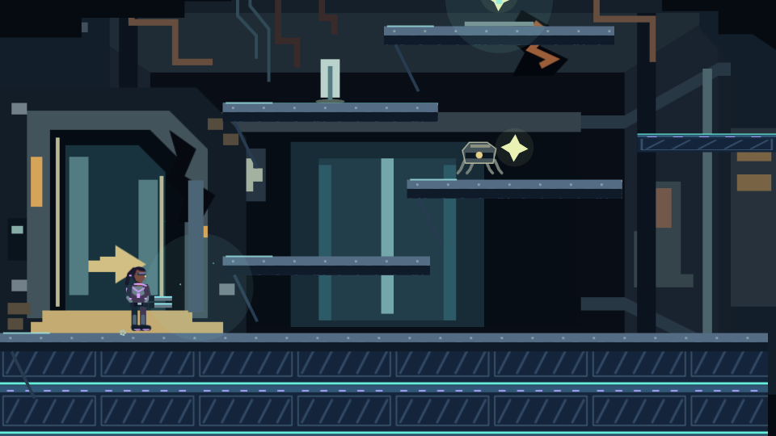
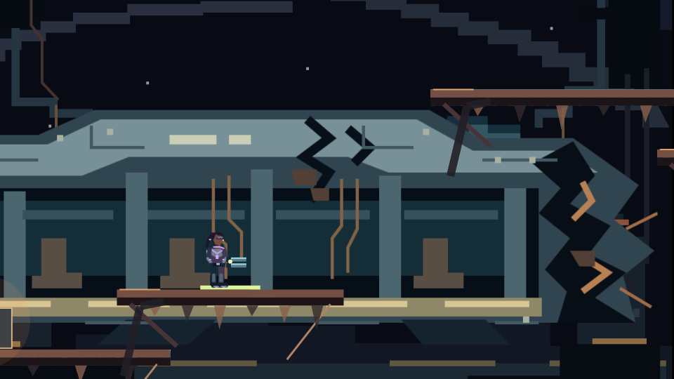
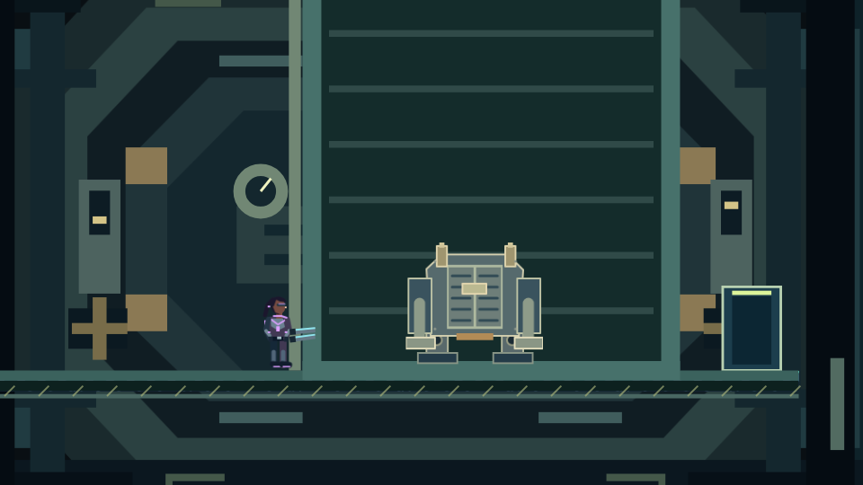
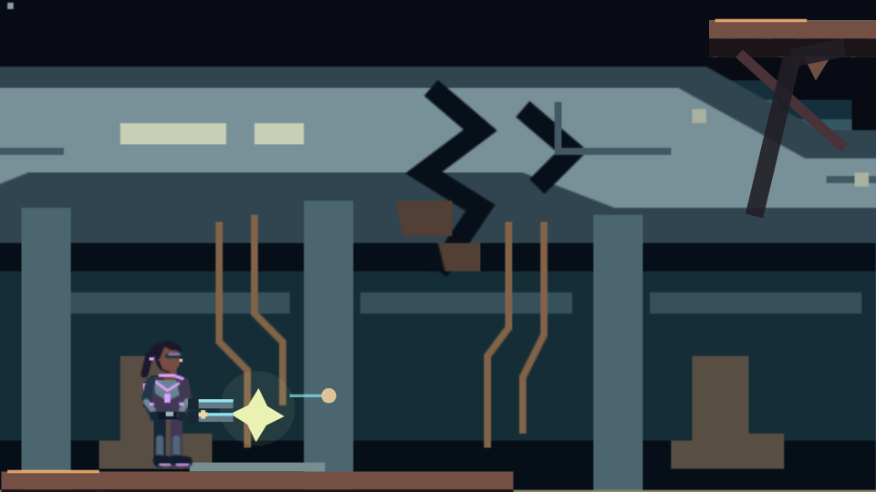
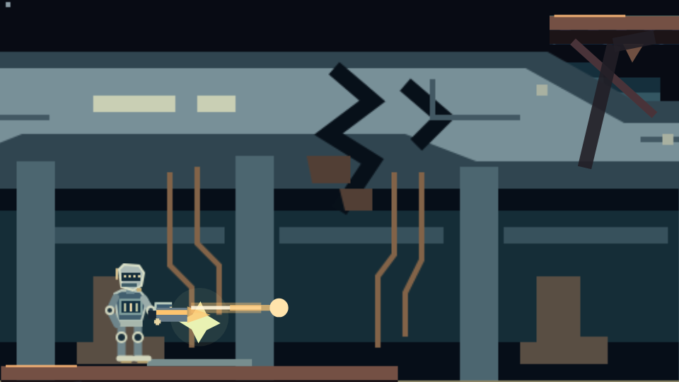
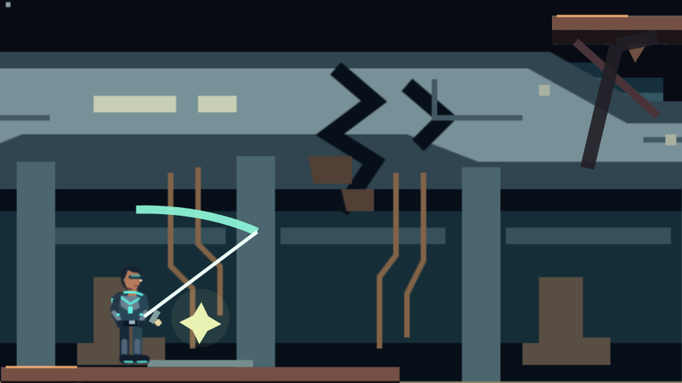

# Mundo 1 — revisão visual e combate · piloto 17.0.0-pilot.2

17 de novembro de 2026. Substitui o relatório funcional do piloto inicial quanto ao visual, combate e resultados do bot. Apenas a pré-visualização foi atualizada; main/v16 continuam intactas. Mundos 2–5 não foram integrados.

Teste: https://echo404-v17-memoria-piloto.buitanda-5186.chatgpt.site/ (acesso privado com a conta proprietária).

## O que estava fraco e o que mudou

O cenário tinha pouca ligação física ao percurso e repetia linguagem visual; as armas emitiam junto ao tronco e o feedback visual era escasso. Toques perto do fim da recuperação podiam perder-se. Na fase 2 do Porteiro, o eco mantinha a vulnerabilidade continuamente aberta, tornando a janela pouco clara.

Agora cada arma tem ombro/mão/cano e ponto de saída calculados com direção, frame e estado no ar. Os projéteis nascem nesse ponto. Há mira assistida limitada, recuo, flash, trilho e sons; inimigos mostram flash, deslocamento de reação e sinal de atordoamento. Impactos mantêm pausa de 50 ms. A janela de memória de ataque é 120 ms e é cancelada por pausa/gesto. Em ?debug aparecem corpo físico 26×66, hitboxes dos inimigos, alcance de lâmina e raios dos projéteis. O raio configurado passou também a ser usado na colisão varrida, corrigindo a divergência do valor fixo anterior.

O Porteiro marca o alvo antes do disparo, mostra PREPARAÇÃO / BLINDAGEM / NÚCLEO EXPOSTO, e a fase 2 exige simultaneamente eco e janela de exposição. A abertura da escotilha acompanha o início da zona 1; o jogador nasce dentro do acesso da nave e sai sob controlo normal, seguindo a luz até às docas. Não há reposicionamento automático na partida.

## Diferenças por zona

| Zona e percurso | Formas e três planos | Elementos utilizáveis / leitura | Luz, partículas e som |
|---|---|---|---|
| 01 · Câmara de Eco: interior da nave → escotilha → doca superior | Cabine com bancos e armário médico; costelas; cabos/anteparas | Escotilha animada no spawn, soleira e seta de saída, plataformas de casco rebitado | Luz fria de orientação, condensação, grave de ventilação e ruído filtrado suave |
| 02 · Cais sem Tripulação: exterior → fuselagem aberta → motor | Planeta e anel orbital partido; pórticos; cabos de doca. Cauda, casco em corte e proa como grandes props próprios | A rota atravessa a fuselagem, sobe pelos destroços e passa junto ao motor; nervuras em primeiro plano, assentos vazios, rachas e vidro quebrado | Luz âmbar intermitente, faíscas nos danos, ruído mais áspero e tom de ressonância metálica |
| 03 · Portão de Quarentena: conduta → eclusa → Porteiro | Portão octogonal; pistões/medidores; condutas e válvulas | Passadiços de manutenção, gate hidráulico atrás da arena e selo do eco | Luz de inspeção, vapor, grave de pressão e modulação de fluxo |

Os fundos deixaram de ser padrões repetidos: são três composições desenhadas, com enquadramento que cobre o viewport e deslocamento relativo limitado entre planos. Zoom mínimo de 0,55 em ecrãs estreitos para tornar operadores/armas maiores; qualidade automática e reduzir efeitos mantidos; o perfil baixo corta camadas/partículas secundárias.

Arte: 13 SVG pixel art originais desenhados com formas explícitas. O script apenas rasteriza, não inventa a geometria dos novos cenários. Não foram usados assets de terceiros. Fontes/licenças MIT do projeto em docs/LICENSES.md, v17/ASSET-LICENSES.md e v17/assets/authored-manifest.json. Não falta nenhum asset obrigatório para esta ronda.

## Armas e valores

Valores editáveis em v17/content/config.js: weapons, rigs e feel. A mira fica limitada à direção em que o operador olha, a 95 unidades na vertical.

| Arma | Mudança visível | Valores principais |
|---|---|---|
| NYRA | Duas saídas alternadas, uma bala por saída/acionamento, braço/cano, recuo, flash e trilho azul | Dano 2; intervalo 90 ms (substitui duas balas simultâneas/180 ms); alcance 520; raio 5; recuo visual 4 |
| KAI-7 | Canhão ligado ao antebraço, carga na boca, feixe/trilho âmbar com núcleo claro, calor e arrefecimento sinalizados | Dano 3/9 carregado; carga 800 ms; intervalo 450 ms; alcance 780; raio 8; recuo visual 8 |
| AXIOM | Guarda/lâmina próprias, arco e rasto de plasma, alinhamento próximo e anel na defesa por timing | Dano 4/8 carregado (+2 no terceiro golpe); carga 700 ms; intervalo 320 ms; alcance 128 (+30 carregado); defesa 200 ms |

O canhão mantém projétil com deslocação, não passa a hitscan. Carga e arco são preparação visual; não foi introduzido atraso adicional no toque normal. As animações de corpo existentes foram mantidas, com arma/braço sobrepostos por desenho dinâmico; não são animações esqueléticas completas.

## Confirmado por teste

Passaram npm test e npm run test:phaser (regressão da v16), npm run test:v17, npm run test:bot:v17, npm run build:v17 e node v17/tests/build.cjs. As migrações de fixtures v14/v15/v16 e o isolamento de cache/dados continuam na suite. Nenhuma escrita foi acrescentada nas chaves antigas.

Novos testes: ponto de saída à esquerda/direita, no chão/no ar, ligação mão–cano, duas saídas alternadas, raio real usado na colisão, buffer/cancelamento, limpeza do arco entre reinícios, contratos dos cenários e exposição temporizada do chefe mesmo com eco no selo.

| Zona | NYRA | KAI-7 | AXIOM |
|---|---|---|---|
| 01 | Passou · 21,0 s · 0 mortes | Passou · 21,6 s · 0 | Passou · 20,3 s · 0 |
| 02 | Passou · 27,2 s · 0 | Passou · 26,6 s · 0 | Passou · 26,1 s · 0 |
| 03 + Porteiro | Passou · 44,1 s · 1 | Passou · 68,3 s · 1 | Passou · 50,8 s · 0 |

Duas mortes: projéteis do Porteiro na fase 3 (NYRA aos 40,6 s; KAI-7 aos 58,9 s). Nove conclusões, três fragmentos por zona, zero uso de habilidades especiais. Bot com comandos normais, dano ativo, gravação de eco, elevador e combate; sem teletransporte ou imunidade artificial. Tempos de uma rota conhecida, não de primeira exploração humana. Dados em V17-BOT.json.

## Capturas para aprovação

Capturas reais do renderer Canvas/Phaser, com enquadramento e posições preparados só para as imagens; não são capturas de um iPhone nem da UI completa do navegador. O bot contínuo é separado e não usa estas posições. Reproduzir: npm run capture:v17. A imagem portrait usa canvas de 320×500.

| Zona 01 | Zona 02 | Zona 03 |
|---|---|---|
|  |  |  |

| NYRA | KAI-7 | AXIOM |
|---|---|---|
|  |  |  |

[Saída da nave](v17-r2-captures/saida-da-nave.png) · [Canvas portrait 320 px](v17-r2-captures/portrait/saida-da-nave.png)

## Não confirmado / teste manual

Não confirmados: ergonomia/precisão percebida, iPhone físico, FPS/GPU, som em chamadas, montagem dos controlos reais a 320 px, navegação offline através do acesso privado e primeira conclusão humana de 2–4 minutos. As capturas não provam estes pontos. Não foi produzido vídeo. Ainda se reutilizam os sprites de corpo anteriores, com rig visual de arma por cima.

No telemóvel, abre o teste, confirma a versão pilot.2, ativa modo puro e testa primeiro a saída da nave. Na zona 2, atravessa o casco e observa as camadas; compara cada arma ao correr, no ar e virada para ambos os lados. No chefe, testa o aviso, a esquiva e o eco na segunda fase. Experimenta reduzir efeitos. Abre ?debug para hitboxes e COPIAR RELATÓRIO. Não apagues dados da v16; a pré-visualização continua numa origem separada.

Paragem nesta ronda. Mundos 2–5 e substituição da v16 dependem da aprovação do proprietário.
